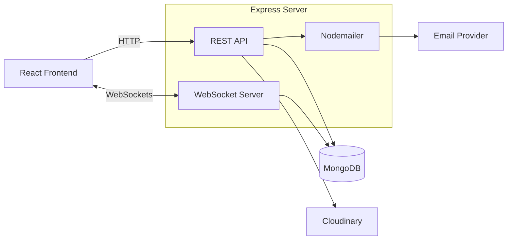

<div align="center">

<svg xmlns="http://www.w3.org/2000/svg" viewBox="0 0 360 100" width="360" height="100" role="img" aria-label="Nepdaa">
  <defs>
    <linearGradient id="bubble" x1="0" y1="0" x2="1" y2="1">
      <stop offset="0" stop-color="#F43F5E"/>
      <stop offset="1" stop-color="#8B5CF6"/>
    </linearGradient>
    <linearGradient id="accent" x1="0" y1="0" x2="1" y2="1">
      <stop offset="0" stop-color="#FDE68A"/>
      <stop offset="1" stop-color="#F59E0B"/>
    </linearGradient>
  </defs>

  <!-- Speech bubble -->
  <path d="M20 18 H76 A14 14 0 0 1 90 32 V58 A14 14 0 0 1 76 72 H52 L36 88 V72 H20 A14 14 0 0 1 6 58 V32 A14 14 0 0 1 20 18 Z" fill="url(#bubble)"/>

  <!-- Heart -->
  <path d="M48 58 C36 49 32 43 32 38 C32 33.5 35.5 30.5 39.5 30.5 C43 30.5 46 32.5 48 35.5 C50 32.5 53 30.5 56.5 30.5 C60.5 30.5 64 33.5 64 38 C64 43 60 49 48 58 Z" fill="#FFFFFF"/>

  <!-- Spark -->
  <circle cx="82" cy="20" r="6" fill="url(#accent)"/>

  <!-- Wordmark -->
  <text x="108" y="60" font-family="Inter, 'Segoe UI', Helvetica, Arial, sans-serif" font-size="46" font-weight="700" fill="#7C3AED" letter-spacing="1">Nepdaa</text>
  <text x="110" y="82" font-family="Inter, 'Segoe UI', Helvetica, Arial, sans-serif" font-size="11" font-weight="500" fill="#F43F5E" letter-spacing="3">SHARE. CONNECT. CHAT.</text>
</svg>

# Nepdaa

**Share your moments. Stay connected.**

A social media platform for sharing posts and stories, with likes, comments, bookmarks, and real-time chat. Built with React, Express, TypeScript, and MongoDB.

<br />


<br />


</div>

---

> [!TIP]
> 🚀 **Ready to Deploy.** Nepdaa is feature-complete for its initial release. See [Deployment](#-deployment) to get it running.

## 📖 About

Nepdaa is a social media platform where users share images and stories, interact through likes, comments, and bookmarks, and talk privately in a real-time messenger.

It is a single full-stack application: a React frontend talks to an Express REST API, and a WebSocket connection powers live chat. Data lives in MongoDB, and media is stored on Cloudinary.

## ✨ Features

| Feature | Description |
| --- | --- |
| 🖼️ **Image posts** | Share photos with the community |
| 📖 **Stories** | Post stories for your followers to view |
| ❤️ **Likes** | Like posts you enjoy |
| 💬 **Comments** | Join the conversation on any post |
| 🔖 **Bookmarks** | Save posts to revisit later |
| ⚡ **Real-time chat** | Instant messaging over WebSockets |
| ☁️ **Media uploads** | Image storage and delivery through Cloudinary |
| 📧 **Email** | Transactional emails sent with Nodemailer |

<!-- VERIFY: confirm what Nodemailer is used for (e.g. verification, password reset) and name it here. -->

## 🧰 Tech Stack

| Layer | Technologies |
| --- | --- |
| **Frontend** | React, TypeScript |
| **Backend** | Express, TypeScript |
| **Database** | MongoDB |
| **Real-time** | WebSockets |
| **Media** | Cloudinary |
| **Email** | Nodemailer |
| **Package manager** | npm |

## 🏗️ Architecture

Nepdaa is a monolithic full-stack application with a single Express server.



<!-- VERIFY: confirm the WebSocket server shares the Express HTTP server, and which routes trigger email. -->

## 📁 Project Structure

```text
nepdaa/
├── client/        # React frontend
├── server/        # Express API and WebSocket server
├── assets/        # Logo and static README assets
└── package.json
```

<!-- VERIFY: replace with the actual folder names and layout of the repository. -->

## 🚀 Getting Started

### Prerequisites

- Node.js and npm
- A MongoDB database (local or hosted)
- A Cloudinary account
- An SMTP provider for Nodemailer

### Installation

```bash
git clone <your-repository-url>
cd nepdaa
npm install
```

<!-- VERIFY: if client and server have separate package.json files, run npm install in each folder. -->

### Configuration

<!-- VERIFY: document the real environment files and variables (e.g. from .env.example). None are listed here to avoid inaccuracies. -->

Create the required environment files for MongoDB, Cloudinary, and your SMTP provider, as described in the repository's example env files. Never commit secrets.

### Run locally

```bash
npm run dev
```

<!-- VERIFY: replace with the exact dev scripts defined in package.json (client and server may start separately). -->

## 🚢 Deployment

1. Provision a MongoDB database (for example, MongoDB Atlas).
2. Set production environment variables for the server, including database, Cloudinary, and SMTP credentials.
3. Build and start the application:

```bash
npm run build
npm start
```

4. Make sure your hosting platform supports WebSocket connections, and that the client points to your deployed API and WebSocket URLs.

<!-- VERIFY: confirm the build and start scripts, and add your hosting platform's specific steps. -->

## 🗺️ Roadmap

- [x] 🖼️ Image posts and 📖 stories
- [x] ❤️ Likes, 💬 comments, and 🔖 bookmarks
- [x] ⚡ Real-time chat
- [x] ☁️ Cloudinary media uploads
- [ ] 🧪 Expanded testing and CI/CD
- [ ] 📈 Monitoring and analytics

<!-- VERIFY: adjust checkmarks and planned items to match reality. -->

## 📄 License

A license has not yet been specified for this project.

<!-- VERIFY: if a LICENSE file exists in the repository, replace this section with its name and a link. -->

---

<div align="center">

**Nepdaa** · Share your moments. Stay connected.

</div>
